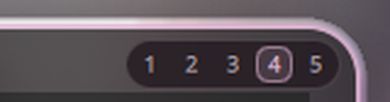

# workspace-on-click

Clickable workspace numbers in the corner of the focused window on **Hyprland**.

A small, unobtrusive pill with `1 2 3 4 5` appears in the top-right corner of the
active window. Click a number and the window is silently sent to that workspace.
No titlebar, no extra bar, no window switcher needed.



## Features

- Numbers follow the focused window on every monitor.
- Current workspace is highlighted; hover shows the target in the accent colour.
- Themed automatically from `~/.config/hypr/scheme/current.lua` (Caelestia-style
  schemes) with a neutral fallback palette.
- Click sends the window to the workspace **without following it**
  (`movetoworkspacesilent`), so your current view stays where it is.
- Works with both classic Hyprland configs and the new Lua configs.
- Shows in tiled, floating, maximized and fullscreen windows, and hides when the
  workspace has no focused window.
- Toggle and chip count adjustable at runtime over IPC.

## Requirements

- Hyprland (Wayland), tested on 0.56.2.
- [Quickshell](https://quickshell.org/) 0.3+ (git is fine).
- On Arch/CachyOS: `pacman -S quickshell` or `yay -S quickshell-git`.

## Install

```bash
git clone https://github.com/crdacoga2016-beep/workspace-on-click
mkdir -p ~/.config/quickshell/workspace-on-click
cp workspace-on-click/shell.qml ~/.config/quickshell/workspace-on-click/
```

Test it:

```bash
qs -c workspace-on-click
```

### Autostart

`hyprland.conf`:

```ini
exec-once = qs -c workspace-on-click -n
```

Hyprland Lua config:

```lua
hl.on("hyprland.start", function()
    hl.exec_cmd("qs -c workspace-on-click -n")
end)
```

### Optional: toggle keybind

Pick any free bind, for example `SUPER + ALT + N`.

`hyprland.conf`:

```ini
bind = SUPER ALT, N, exec, qs -c workspace-on-click ipc call wsnums toggle
```

Hyprland Lua config:

```lua
hl.bind("SUPER + ALT + N", hl.dsp.exec_cmd("qs -c workspace-on-click ipc call wsnums toggle"))
```

Other IPC commands:

```bash
qs -c workspace-on-click ipc call wsnums enable
qs -c workspace-on-click ipc call wsnums disable
qs -c workspace-on-click ipc call wsnums setCount 3   # show only 1..3
```

## Configuration

Edit the top of `shell.qml` or use environment variables:

| Variable        | Default                                     | Description                       |
| --------------- | ------------------------------------------- | --------------------------------- |
| `WSNUMS_CHIPS`  | `5`                                         | Number of chips (1..9)            |
| `WSNUMS_SCHEME` | `~/.config/hypr/scheme/current.lua`         | Lua colour scheme to read         |

Sizes, insets and opacities live in the `PanelWindow`/`Rectangle` properties
(`chipSize`, `chipGap`, `padding`, `insetX`, `insetY`) if you want to fine-tune
the look.

## Recommended companion keybinds

This project only handles the clickable numbers. If you prefer the Windows-ish
layout where a modifier plus a number *moves* the window instead of switching
workspace, swap the usual binds:

`hyprland.conf`:

```ini
bind = SUPER ALT, 1, workspace, 1
bind = SUPER, 1, movetoworkspacesilent, 1
# ...repeat for 2..0
```

Hyprland Lua config (Caelestia variables):

```lua
kbGoToWs      = "SUPER + ALT"
kbMoveWinToWs = "SUPER"
```

## How it works

- A Quickshell `ShellRoot` creates one small layer-shell surface per monitor
  (`WlrLayer.Overlay`, `ExclusionMode.Ignore`, keyboard focus none). The surface
  is exactly the size of the pill, so clicks everywhere else pass through to the
  window normally.
- The focused window is found from Hyprland's client list (`focusHistoryID == 0`)
  and must be on the monitor's active workspace.
- Hyprland does not push focus/geometry changes to Quickshell's client cache, so
  the overlay calls `Hyprland.refreshToplevels()` every 250 ms.
- Clicking dispatches `movetoworkspacesilent <ws>,address:<addr>` (or the Lua
  equivalent) after a 140 ms press animation.

## Troubleshooting

- **No pill:** check the log (the path is printed when Quickshell starts), make
  sure `qs -c workspace-on-click` is running, and verify the layer exists with
  `hyprctl layers | grep wsnums`.
- **It does not appear on a window:** the window must be focused and on the
  monitor's active workspace. Special workspaces are skipped.
- **Wrong colours:** point `WSNUMS_SCHEME` at your scheme, or edit `palette` in
  `shell.qml`.
- **Clicks pass through?** Some overlays grab input on the same layer; check your
  other layer rules/namespaces.

## License

MIT
